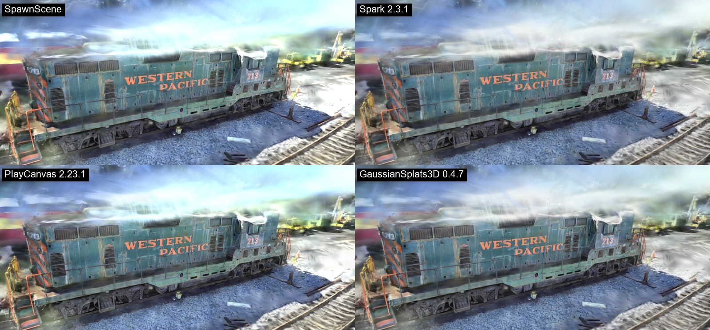
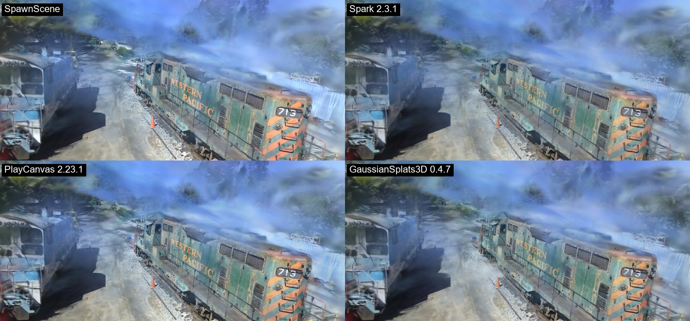
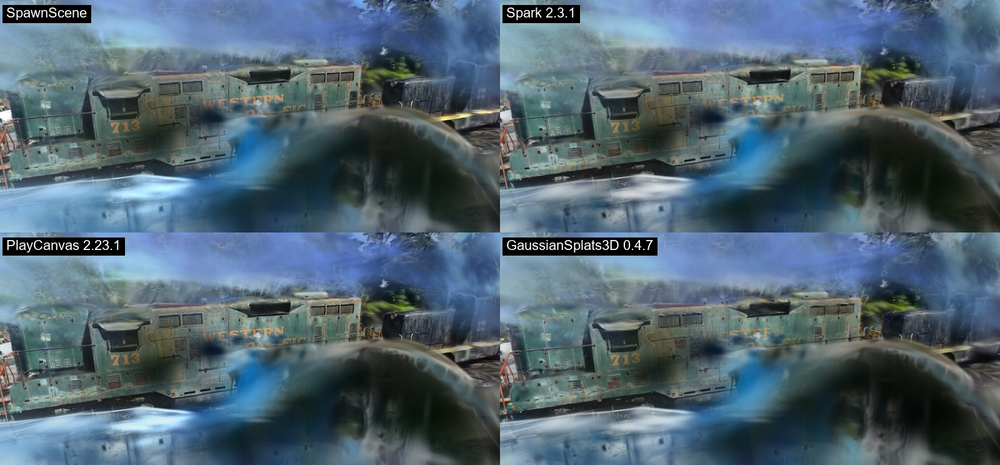

# SpawnScene benchmarks

How SpawnScene's scenes and viewer compare with other Gaussian splatting tools, measured, with the protocol stated so
anyone can repeat it. Every number here comes from a run whose log is kept; where a comparison is still being measured
it says so.

## Protocol

- **Held-out photos.** Every 8th photo (sorted by name) is never trained on; PSNR and SSIM are measured on those -
  the standard 3DGS / Mip-NeRF 360 split (`--test_every 8` in gsplat, `llffhold=8` in SpawnScene).
- **Same inputs.** Same photos at the same resolution and, unless stated, the same COLMAP camera poses for every tool -
  a comparison of trainers, not of pose estimators.
- **Same iteration count** (7K or 30K, the reference's two checkpoints).
- **Fair exposure score** (SpawnScene logs it for every run): phone photos are exposed one by one, so we also fit each
  held-out photo's per-channel gains on its LEFT half and score its RIGHT half - the reference 3DGS's
  `--train_test_exp` protocol. Without it a scene that learned the photos' average exposure is scored against photos it
  was never meant to match.
- Hardware: NVIDIA RTX 4070 (12 GB), Chrome 151, Windows 11. gsplat on the same machine (CUDA 12.4, PyTorch 2.4.1).

## Training quality

Eleven standard scenes (Mip-NeRF 360, Tanks and Temples, Deep Blending), three trainers, **one scorer** for all of them
(`tools/rescore.py`: PSNR / SSIM / LPIPS-AlexNet on the held-out renders each tool saved - each tool's own scorer
differs). Same images at the same resolution, the same COLMAP poses and the same split for every tool. Every run of every
tool **ends** its schedule at the iteration count shown (a "7K" row is a 7,000-step run, not step 7,000 of a 30K run).
Higher PSNR / SSIM and lower LPIPS are better.

| Mean over the 11 scenes | 7K steps | 30K steps |
|---|---|---|
| **SpawnScene** (WebGPU, in a browser tab) | **27.44 / 0.862 / 0.166** | 28.43 / 0.881 / 0.128 |
| Brush v0.3.0 (WebGPU, in a browser tab) | 26.95 / 0.841 / 0.200 | **28.63 / 0.883 / 0.122** |
| gsplat 1.5.3 `default` (CUDA) | 26.73 / 0.833 / 0.207 | 28.50 / 0.896 / 0.140 (8 scenes, see below) |
| Best PSNR | SpawnScene on 9 of 11 | Brush on 8 of 11, SpawnScene on 3 |

**What this says, plainly:** at 7K SpawnScene leads both (+0.49 dB over Brush, +0.71 over gsplat, best mean SSIM and
LPIPS). At 30K **Brush leads** by 0.20 dB on the mean: it wins every indoor scene (Train by 1.16 dB, Bonsai 0.69, the rest
0.1-0.2) and SpawnScene wins Bicycle, Garden and Playroom. Against gsplat at 30K SpawnScene is ahead on 7 of the 8 scenes
it finished (+0.55 dB mean over those 8) with about 40% of its splats in about half the time. Closing the 30K gap to
Brush is the open work.

### 7K, per scene (2026-10-11)

| Scene | SpawnScene | Brush v0.3.0 | gsplat 1.5.3 |
|---|---|---|---|
| Bicycle | **24.89 / 0.748 / 0.212** | 24.00 / 0.677 / 0.323 | 23.75 / 0.640 / 0.367 |
| Garden | **26.86 / 0.845 / 0.110** | 26.14 / 0.804 / 0.166 | 25.99 / 0.809 / 0.149 |
| Stump | **26.48 / 0.765 / 0.187** | 25.30 / 0.694 / 0.300 | 25.00 / 0.682 / 0.304 |
| Room | **30.87 / 0.915 / 0.176** | 30.25 / 0.907 / 0.190 | 30.07 / 0.899 / 0.203 |
| Counter | **27.92 / 0.894 / 0.179** | 27.61 / 0.889 / 0.184 | 27.60 / 0.888 / 0.189 |
| Kitchen | **29.78 / 0.917 / 0.112** | 29.18 / 0.907 / 0.123 | 29.37 / 0.913 / 0.117 |
| Bonsai | 30.18 / **0.930 / 0.146** | **30.47** / 0.929 / 0.147 | 30.15 / 0.926 / 0.151 |
| Truck | **24.82 / 0.871 / 0.120** | 24.71 / 0.860 / 0.132 | 23.88 / 0.852 / 0.134 |
| Train | 20.22 / 0.784 / 0.221 | **21.07 / 0.792 / 0.200** | 20.42 / 0.771 / 0.231 |
| DrJohnson | **29.23 / 0.906 / 0.196** | 28.22 / 0.896 / 0.226 | 28.28 / 0.889 / 0.230 |
| Playroom | **30.60 / 0.913 / 0.171** | 29.51 / 0.900 / 0.206 | 29.47 / 0.897 / 0.199 |

SpawnScene trains a 7K scene in 130-234 s on an RTX 4070 (Truck 130 s, Bicycle 234 s).

### 30K, per scene (2026-10-11/12)

| Scene | SpawnScene (splats, time) | Brush v0.3.0 (time) | gsplat 1.5.3 (splats, time) |
|---|---|---|---|
| Bicycle | **25.51** / 0.789 / **0.140** (3.72M, 24 min*) | 25.47 / 0.789 / 0.145 (18 min) | did not finish on 12 GB (below) |
| Garden | **27.77 / 0.872 / 0.073** (2.18M, 21 min*) | 27.62 / 0.865 / 0.082 (17 min) | not run (same limit) |
| Stump | 27.05 / 0.793 / 0.132 (2.54M, 18 min) | **27.19 / 0.801 / 0.128** (15 min) | not run (same limit) |
| Room | 32.16 / 0.926 / 0.147 (0.92M, 19 min*) | **32.35 / 0.929 / 0.144** (16 min) | 31.30 / 0.916 / 0.160 (2.26M, 32 min) |
| Counter | 29.18 / 0.910 / 0.146 (0.68M, 18 min*) | **29.30 / 0.912 / 0.143** (15 min) | 29.09 / 0.909 / 0.147 (1.67M, 29 min) |
| Kitchen | 31.55 / **0.929 / 0.091** (0.90M, 21 min*) | **31.68** / 0.927 / 0.094 (14 min) | 31.06 / 0.925 / 0.096 (2.15M, 35 min) |
| Bonsai | 31.95 / 0.943 / 0.124 (0.68M, 14 min) | **32.64 / 0.946 / 0.117** (16 min) | 32.04 / 0.941 / 0.123 (1.86M, 29 min) |
| Truck | 25.95 / 0.888 / 0.091 (1.03M, 11 min) | **26.04 / 0.893 / 0.075** (12 min) | 25.17 / 0.877 / 0.093 (3.78M, 35 min) |
| Train | 21.65 / 0.822 / 0.149 (0.74M, 11 min*) | **22.81 / 0.836 / 0.118** (19 min) | 21.60 / 0.816 / 0.144 (1.84M, 20 min) |
| DrJohnson | 29.52 / 0.907 / 0.163 (1.79M, 17 min) | **29.66 / 0.912 / 0.153** (18 min) | 28.33 / 0.888 / 0.184 (5.21M, 47 min) |
| Playroom | **30.45 / 0.913** / 0.149 (0.97M, 13 min) | 30.21 / 0.905 / **0.143** (13 min) | 29.40 / 0.899 / 0.169 (3.15M, 32 min) |

SpawnScene densifies until 15K like gsplat (`refine_stop_iter`) and ran with an 8 GB training budget (`&gpumem=8`; the
default 4 GB caps a scene at about 3.3M splats). Times: SpawnScene's are its training loop alone, Brush's and gsplat's wall clock including loading and evaluation
(so ours read slightly short); \* marks SpawnScene runs that shared the
machine with other work for part of the run, so their times are not clean (the scores are unaffected). Brush's splat
counts were not recorded. **gsplat on a 12 GB card:** its default Bicycle 30K filled the RTX 4070's memory at about
step 13,000 (11.4 of 12.3 GB) and slowed from 20 to under 1 step a second as Windows spilled it to system memory - 11 more
hours to go when it was stopped. Garden and Stump grow as large and were not run. SpawnScene trained Bicycle in 3.72M
splats.

Provenance: `Research/parity-matrix.md` ("Three-way on TODAY'S defaults", "30K three-way"), run logs kept
(`_runs/tuvok-tw-*`, `_runs/tuvok-p30*`).

### Without COLMAP

SpawnScene places the cameras itself (learned matching + GPU structure from motion). On Bicycle the held-out score with
its own poses is 25.17 dB / 0.765 (run b0r, 2026-10-08) against 25.07 / 0.766 with COLMAP's - posing in the browser
costs nothing measurable there.

### Phone captures

The benchmarks have no auto exposure and no thin coverage; phone photos of a room have both. A 35-photo capture of a
bathroom (held out every 8th photo):

| SpawnScene version | held out PSNR / SSIM | fair score |
|---|---|---|
| before 2026-10-07 (sparse SfM init, no exposure model) | 15.58 dB / 0.709 | - |
| + seeds from the photos' depth | 16.88 / 0.796 | 18.88 |
| + per-photo exposure gains (current default) | **18.57 / 0.844** | **24.32** |

## Viewer

The same scene in four browser viewers, from the same seven camera poses: Inria's *Train* at 7K iterations
(741,883 splats, SH degree 3, the reference trainer's PLY), 1600x900 at device pixel ratio 1, vertical field of view
50°. Pose 0 is a home view; poses 1-6 are pseudo-random (seeded) around the scene - 5-35° above it, 1.2-2.2 scene
radii away - so no viewer was tuned for them. Measured 2026-10-08 on an RTX 4070 (driver 596.21), Chrome 151,
Windows 11. Tools: `tools/viewer-bench/` (pages, `make_poses.py`, `compose_sheets.py`) and
`tools/_cdp_viewer_bench.js`.

| Viewer | Version | API | Defaults changed |
|---|---|---|---|
| SpawnScene | 2026-10-08 | WebGPU | none |
| [Spark](https://sparkjs.dev) | 2.3.1 (three.js 0.186.1) | WebGL2 | none |
| [PlayCanvas](https://playcanvas.com) (SuperSplat's engine) | 2.23.1 | WebGL2 | none |
| [GaussianSplats3D](https://github.com/mkkellogg/GaussianSplats3D) | 0.4.7 | WebGL2 | SH degree 3 (its default is 0) |

### What they draw

All four draw the same picture; differences are small and mostly sharpness. SpawnScene applies contrast-adaptive
sharpening by default (strength 0.5, a Settings slider), so its frames look crisper than the raw blend the others show.
Mean absolute pixel difference from GaussianSplats3D (0-255, the frame band below): SpawnScene 8.6-17.4, PlayCanvas
6.5-12.5, Spark 3.9-6.7.

All seven: [img/viewer-bench/](img/viewer-bench/) (`train-pose0..6.jpg`).

### Frame rate

At the display's 60 Hz every viewer held 60 fps at every pose. Uncapped (Chrome with vsync and the frame-rate limit
off), frames per second, two rounds:

| Pose | SpawnScene | Spark | PlayCanvas | GaussianSplats3D |
|---|---|---|---|---|
| 0 | 261 / 261 | 1149 / 784 | 491 / 504 | 474 / 473 |
| 1 | 309 / 309 | 403 / 145 | 969 / 585 | 555 / 559 |
| 2 | 267 / 267 | 670 / 485 | 531 / 1074 | 462 / 463 |
| 3 | 259 / 259 | 425 / 585 | 317 / 368 | 425 / 425 |
| 4 | 240 / 240 | 437 / 809 | 337 / 470 | 415 / 414 |
| 5 | 222 / 221 | 212 / 413 | 310 / 251 | 392 / 392 |
| 6 | 238 / 238 | 719 / 305 | 458 / 468 | 421 / 415 |

What this says, plainly:

- **SpawnScene is the slowest of the four uncapped**, at 221-309 fps (3.2-4.5 ms a frame) against 392-559 for
  GaussianSplats3D. The gap is a steady factor, not a fixed overhead: SpawnScene runs at 0.55-0.61x GaussianSplats3D's
  rate at every pose, rising and falling with it, so the extra cost grows with the splats drawn. Finding it is open
  work. Drawing every splat (`&lodpx=0`, no 0.3 px cull) measured the same.
- **SpawnScene and GaussianSplats3D repeat within 1%** between rounds. Spark and PlayCanvas do not: up to 2.8x apart
  at an unchanged camera.
- **The uncapped numbers do not measure the same work.** Spark, PlayCanvas and GaussianSplats3D sort on a worker
  thread and draw each frame with the latest finished order. Uncapped, Spark's sort fell behind its drawing: at poses
  4-6 in some rounds it drew with a stale order (the train's far side painted over its near side). At 60 Hz the same
  poses drew correctly, and those are the Spark frames shown above. A frame counter cannot see that, so read the
  Spark and PlayCanvas columns as drawing speed, not sorted-drawing speed.

### Where SpawnScene's frame time goes

Measured with harness-only switches on the same poses ([Research/viewer-speed-2026-10-08.md](../Research/viewer-speed-2026-10-08.md)):

- **The 16-bit float blend target.** SpawnScene blends splats into an `rgba16float` image; the same renderer blending
  into 8 bits runs 1.37-1.42x faster. We keep 16 bits on purpose: 8-bit blending changes the picture by up to 120/255
  in places (24-30 dB) - it clamps after every splat, while the trainer composites unclamped - and cost the viewer
  0.7-3.6 dB against the trainer's own renders when we measured it (2026-09-24).
- **Not pixel count.** Ellipse-aligned quads rasterise about 20% fewer pixels than SpawnScene's axis-aligned ones and
  give an identical image, but measured no faster. A depth attachment that rejects nothing costs under 1%.
- **Which pictures agree** (mean PSNR over the seven poses): SpawnScene and PlayCanvas 31.2 dB; SpawnScene's 8-bit
  variant and Spark 31.7 dB, and GaussianSplats3D 30.2 dB; GaussianSplats3D and Spark 30.1 dB; SpawnScene and
  GaussianSplats3D 23.8 dB. Which of these is closest to a reference renderer at these poses has not been measured yet.

### GPU memory

Measured with the scene open (nvidia-smi, Inria *Train* 7K, 741,883 splats, SH degree 3), since 2026-10-12:

| | bytes a splat | Train 7K scene |
|---|---|---|
| Before (f32 everywhere) | ~299 | 1091 MiB |
| Now (default: 8-bit SH bands with a per-band step, 36-byte draw vertex, compact source rows) | ~132 | 976 MiB |

That is about 2.3x as many splats in the same memory. The render changes by 60 dB PSNR from the f32 one (max 1-3 of 255,
also on needle-heavy Truck seen close up; source-row compaction alone changes no pixel), and the frame rate is the same
(Train 256.5 vs 256.2 fps, Truck 328.2 vs 327.7, uncapped). `&shq8=0` / `&rowq=0` turn the two options off.
Details: [Research/viewer-memory-2026-10-11.md](../Research/viewer-memory-2026-10-11.md).

### Formats

SpawnScene opens 3DGS `.ply` (including Brush's exports), SuperSplat compressed `.ply`, PlayCanvas `.sog`, Niantic `.spz`
(v2, v3 and the zstd-compressed v4) and `.splat`, decoding all of them on the GPU (v4's zstd streams are decompressed by
ZstdSharp first: browsers have no zstd decoder). Each decoder is tested against the format owner's reference decoder (ported) and
verified on the owner's published sample files - see [Research/scene-formats-2026-10-08.md](../Research/scene-formats-2026-10-08.md).

## Training in a browser: who else does it

[Brush](https://github.com/ArthurBrussee/brush) (Rust, wgpu) also trains 3DGS in a browser tab; it is in both tables
above. SpawnScene is ahead at 7K and behind at 30K (0.20 dB on the mean, most of it on Train and Bonsai). Desktop
trainers (gsplat, the reference 3DGS) are the quality bar.
